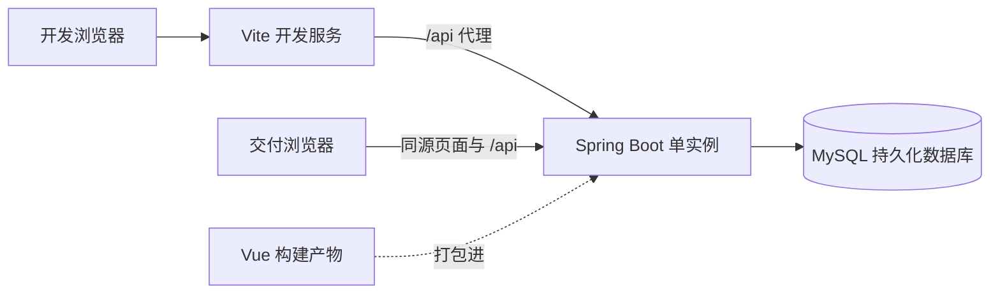
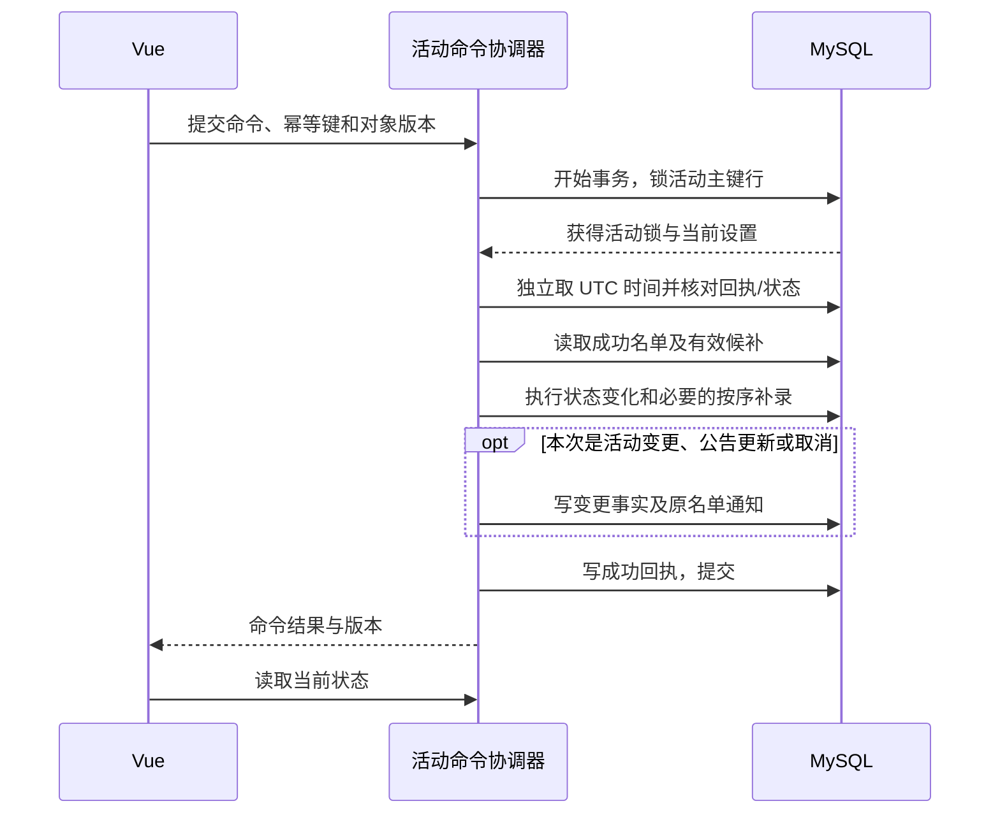

# 班级与社团活动报名管理架构说明

第一版采用 **Vue＋Spring Boot＋MySQL、前后端分离、后端单体**。这是用户选择的高层方案；本文其余机制按“快速初稿”起草，供两位成员开发和课程老师检查。它说明如何让报名、退出、补录与通知遵守同一套规则，不代表软件已实现或测试通过。

当前依据为 [PRD](prds/prd-campus-event-signup-2026-11-25/prd.md) 的 23 条功能需求和 4 条非功能需求。后续实现共同遵守的规则、数据关系图和版本种子在 [ARCHITECTURE-SPINE](architecture/architecture-campus-event-signup-2026-11-26/ARCHITECTURE-SPINE.md)；每项备选、取舍与验证计划见 [8 条 ADR](architecture/architecture-campus-event-signup-2026-11-26/adrs.md)。两份文件按 AD-1/ADR-001 至 AD-8/ADR-008 对应。

## 1 组件与交付

Vue 负责页面、表单、状态展示和调用接口；Spring Boot 负责身份、所有权、时限、状态迁移和名额；MySQL 保存业务与通知。后端按身份、活动、参与、通知分模块，由应用层协调跨模块写入。页面不能根据剩余名额自行宣布报名成功。

开发时保留前后端各自的构建与调试；交付时前端构建产物由 Boot 同源提供，减少 Cookie、跨域和部署配置。公网托管及 TLS 提供者尚未选择；当前未安装 JDK/MySQL、未生成业务脚手架、未部署服务。已有 Node/npm 版本及官方生成器内容检查不等于构建验证。

## 2 名额、退出与补录怎样保持一致

同一场活动的写操作通过一个协调入口，先锁定活动记录，再检查服务端时间、身份、状态和人数。这使得两个人争抢最后一席时，后一个命令会基于前一个已提交的结果重新判断。

关键区别是“参加申请”和“退出申请”：前者待审不占位，后者待审仍然报名成功、仍占位。退出真正生效才产生空位，并在当前为先到先得、未开始且未取消时按旧申请顺序补录。重报生成新尝试，原排队位置不复活。

这套方案的代价是同一活动写入需要排队；它以小型活动为当前目标，不承诺未经测试的高吞吐。事务内不做外部通知或网络调用。后续用真实 MySQL 验证最后一席、切换与退出交错、锁等待跨过开始时间等场景。

## 3 开始、截止与取消是不同边界

报名截止只阻止新申请，已有申请仍可在活动开始前审核或补录；截止事实会持久保存，改期不能重开已截止报名。模式切换保留有效旧申请的原时间；开始后不能改业务设置，也不能取消整场活动，只能改普通信息与公告。

整场取消会关闭未处理申请并停止个人业务处理，但保留历史成功记录。活动列表统一把取消活动排在所有未取消活动后，并标“活动已取消”；详情、原因、历史和通知仍可查。不会用“删除活动”代替取消，也不会把历史成功者记成主动退出。

## 4 身份与站内通知

采用服务端 Session 和 CSRF，登录身份由服务端取得；用户是否为发起者按当前活动的 owner 判断。完整名单、退出理由和站内通知按各自所有权限制读取。前端不保存可自行宣布管理权限的角色标志。

活动信息、模式、公告变更或取消时，先取变更前的成功名单，再把变更记录和站内通知一起提交；任何一步失败，整个变更回滚。通知采用数据库记录及未读状态，不增加邮件、短信或消息队列。通知不会夹带私密退出理由。

## 5 后续实现与验证

| 设计结果 | 对应后续检查 |
|---|---|
| AD-2 至 AD-4：事务、状态和公平顺序 | NFR-01：真实 MySQL 并发与边界用例 |
| AD-5、AD-7：会话、资源权限和契约 | NFR-02：允许/拒绝路径，旧凭据与跨用户请求 |
| AD-3、AD-8：历史、迁移与持久化 | NFR-03：正常重启及干净检出复现 |
| AD-6、AD-7：通知与重复命令 | NFR-04：失败回滚、接收者快照、去重及已读隔离 |

本轮技术建议仍需审阅：活动级行锁与同步补录、Session＋CSRF、当前槽位与历史尝试、幂等回执及具体版本。PRD 已保留的发起者自报名、字段、部分改期细则和测试预算，在对应故事或测试计划前确认，不在本稿偷偷补成业务结论。

下一阶段把架构约束纳入共同实现规则，再正式拆分至少 3 个史诗和 12 个带可测试 AC 的故事；实施就绪检查后规划两个冲刺。实验 A 的配对故事须在实现前选定，不能先写完再补对照记录。组员技能和实际分工仍待补充。
