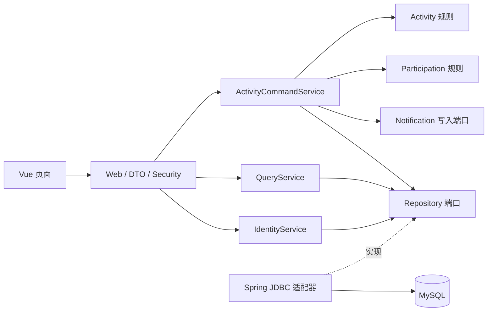
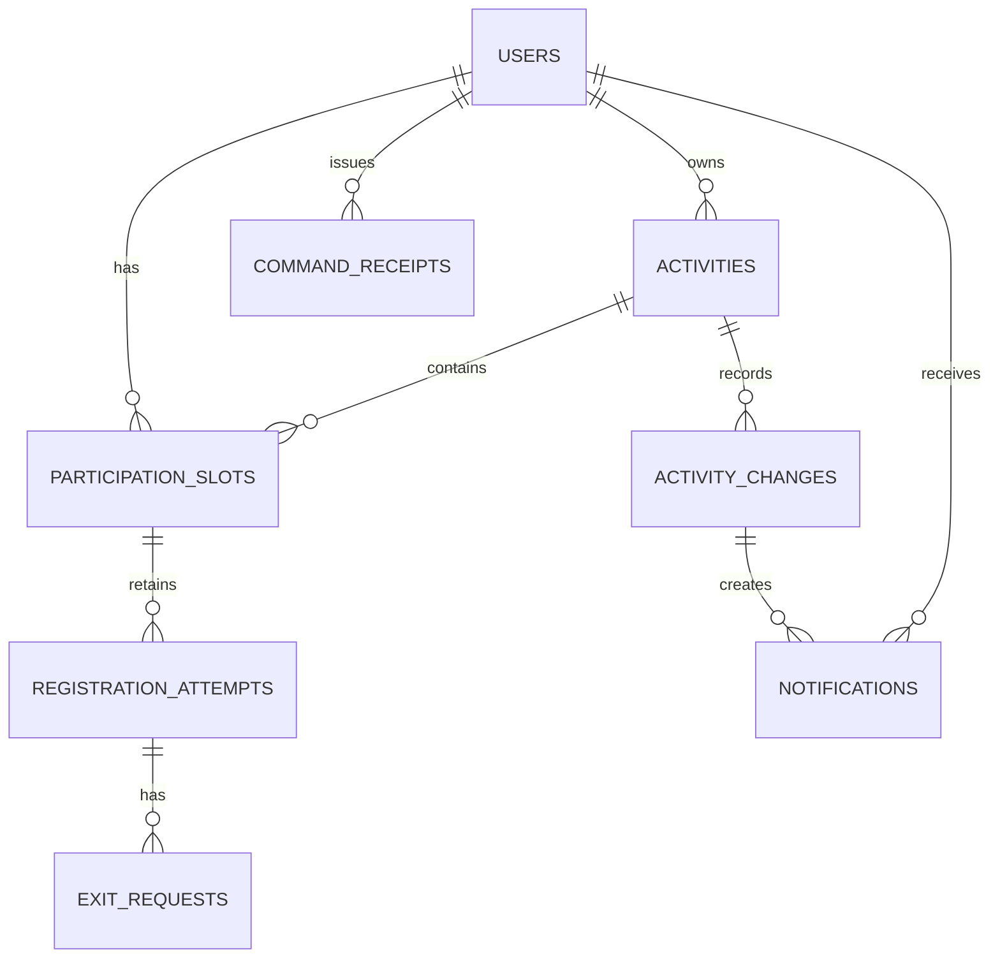

# Architecture Spine — campus-event-signup

用户已选择 Vue、Spring Boot、MySQL、前后端分离且后端保持一个应用，并选择快速初稿。AD-1 的这部分标为 [ADOPTED]；AD-2 至 AD-8 是本轮技术建议 `[ASSUMPTION T-1]`，尚未经过用户逐项审阅。本文可供评审，不表示已生成项目或通过运行测试。取舍见 [ADR](adrs.md)，阅读说明见 [架构说明](../../architecture.md)。

## Design Paradigm

采用**模块化分层单体**：`web → application → domain`，持久化适配器实现应用层端口；业务状态只有后端能裁决。模块为 identity、activity、participation、notification；`ActivityCommandService` 是一场活动所有变更的事务协调入口。不同模块是代码边界，不是独立部署的微服务。



## Invariants & Rules

### AD-1 — Vue 与 Java 单体的边界 [ADOPTED]

- **Binds:** 全系统；FR-01 至 FR-23。
- **Prevents:** 前端与后端分别计算报名成功，或拆出第二个名单写入服务。
- **Rule:** Vue 通过 `/api` 调用 Spring MVC JSON 接口；后端为一个 Spring Boot 应用、一个业务数据库。前端不直接访问数据库，不据按钮状态决定名额、身份或时限。activity 拥有活动设置，participation 拥有申请与退出状态，notification 拥有通知；跨模块写操作只经应用层协调器，不互调对方 Controller 或绕过端口直接写表。

### AD-2 — 每场活动一个写事务边界

- **Binds:** FR-03、FR-04、FR-06 至 FR-14、FR-18 至 FR-23；NFR-01、NFR-04。
- **Prevents:** 扣位、模式切换、退出批准或通知接收者快照采用互不兼容的锁与计数。
- **Rule:** 已存在活动的全部业务写入先在同一 Spring JDBC `READ_COMMITTED` 事务内，按活动主键执行 `SELECT … FOR UPDATE`；再读申请、校验权限和状态、计数并变更。所有写入路径遵守该顺序，包括普通信息、公告和退出申请，不使用独立的 `REQUIRES_NEW` 事务或提交后补写。新草稿创建在独立事务内建立活动根。一个命令只处理一场活动，不持锁调用外部服务。
  名额真值为该活动 `registration_attempts.state = CONFIRMED` 的记录数；不维护第二份可写的已占人数。提交时人数不能超过容量。待审、候补不占位，退出待审仍为 CONFIRMED。取消后原成功记录保留为历史，不再分配名额。读取容量与人数时采用同一 SQL 快照，不能拼接不同时刻的值。

### AD-3 — 当前申请与历史申请分离

- **Binds:** FR-09 至 FR-19、FR-22；NFR-01、NFR-02。
- **Prevents:** 重报复用旧排队时间、退出待审被当成未报名，或旧审核请求修改新一轮报名。
- **Rule:** `participation_slots` 对 `(activity_id, user_id)` 唯一，仅指向该用户在该活动的一条当前 `registration_attempt`；每次重报创建新 attempt，旧 attempt 保留。待审、候补、成功属于当前记录；拒绝、撤回、退出后清除当前指针。外键与应用校验共同保证指针归属，禁止指向别人的申请。
  `exit_requests` 独立保存退出理由与处理状态；报名仍成功时可有至多一条待审退出请求，由 attempt 的 `pending_exit_request_id` 指向。直接退出、退出批准、退出撤回或拒绝时同步关闭或清除该指针；旧请求不得再次释放名额。状态名、合法变化及取消语义按下表统一，不能为同一语义另起一套前端枚举。

| 对象 | 持久化状态 | 边界 |
|---|---|---|
| 活动 | DRAFT、PUBLISHED、CANCELLED | 是否已开始由时间判断；取消是独立终态 |
| 报名尝试 | PENDING、WAITLISTED、CONFIRMED、REJECTED、WITHDRAWN、EXITED、CLOSED_ACTIVITY_CANCELLED | 只有 CONFIRMED 占位；报名期内重报使用新 attempt |
| 退出请求 | PENDING、APPROVED、REJECTED、WITHDRAWN、CLOSED_ACTIVITY_CANCELLED、CLOSED_PARTICIPATION_ENDED | 最后一项用于改自由退出后本人直接退出，保留原待审历史 |

整场取消时，PENDING / WAITLISTED 及待审退出请求变为 CLOSED_ACTIVITY_CANCELLED；原 CONFIRMED 保留，页面结合活动 CANCELLED 显示历史成功记录，不能标作本人主动退出。活动开始后未处理的请求不自动批准，保留原状态并派生“处理已截止”提示。

| 报名尝试变化 | 允许的触发（仍须满足权限、时限和容量） |
|---|---|
| 新建 → PENDING / CONFIRMED | 分别为审核模式提交、先到先得成功；后者须先处理有效旧候补 |
| PENDING → CONFIRMED / REJECTED | 当前审核模式下由发起者审核；转先到先得时也可按序进入 CONFIRMED |
| PENDING → WAITLISTED | 审核转先到先得，按序处理后仍未录入 |
| WAITLISTED → CONFIRMED / PENDING | 分别为按序补录、切回审核 |
| PENDING / WAITLISTED → WITHDRAWN | 本人撤回尚未入名单的申请 |
| CONFIRMED → EXITED | 当前允许自由退出，或退出申请获批；退出待审本身不触发此变化 |
| PENDING / WAITLISTED → CLOSED_ACTIVITY_CANCELLED | 整场活动取消 |

REJECTED、WITHDRAWN、EXITED、CLOSED_ACTIVITY_CANCELLED 不再向其他报名状态变化；重报只能新建 attempt。退出请求仅能从 PENDING 进入 AD-3 所列其他退出状态，终态不复用。

### AD-4 — 单一时间源与同步顺序补录

- **Binds:** FR-06 至 FR-14、FR-18、FR-19、FR-22、FR-23；NFR-01。
- **Prevents:** 新报名插队、两个补录器重复录入、等待锁后仍使用已经过期的时间，或改期重新开放报名。
- **Rule:** 获得活动锁后，用**另一个 SQL 语句**取 `UTC_TIMESTAMP(6)`；该值作为本次命令的业务时点。不能把取时放进可能等待锁的同一查询，也不采用请求到达时的旧时间。报名窗口为 `open ≤ now < close`；参加/退出处理、模式设置及整场取消须 `now < start`。开始后普通信息和公告仍可修改。
  本段开始/截止的运营限制针对已发布活动及其申请。DRAFT 从未开放报名，不因暂填过去时间推导“活动已开始”或不可逆的报名关闭事实；草稿仍须满足其已填字段的合法性与相关时间先后关系。此澄清不允许已发布活动重开已截止报名。
  新 attempt 的 `submitted_at` 由服务端在受理时赋值，并在活动锁下分配活动内唯一的 `application_seq`；队列键固定为 `(submitted_at, application_seq)`。模式切换不改变该键，重报分配新键。审核转先到先得、扩容、自由退出及退出获批，在当前事务中按队列键同步补录有效旧候补，补满或无候补为止；开始后、取消后和审核模式不补录。新报名不能绕过旧候补；原先到先得满额失败者不会因此自动进入候补。
  锁后首次取时不能代替最终边界检查：分配名额前及命令最终写入前重新读取数据库时间，按本命令所需的截止/开始边界校验；若批量处理期间已过适用时限则整条命令回滚，不能提交部分临时补录。时间编辑还须依据编辑前的开始时间校验修改权限，不能在处理跨越原开始边界后靠新时间补救。
  修改时间前先检查旧截止时间及持久化的 `admission_closed_at`。若旧报名已截止则保存关闭事实；修改后的截止也已到达时同样关闭。新报名资格同时要求“未持久关闭、未到当前截止”；任何编辑不能清除关闭事实。无需后台定时器才能防止改期重开。

### AD-5 — 服务端会话、CSRF 与资源所有权

- **Binds:** FR-01、FR-02、FR-09、FR-16、FR-19 至 FR-22；NFR-02。
- **Prevents:** 客户端伪造发起者、退出后旧凭据仍能写入、跨用户读取退出理由或通知。
- **Rule:** Spring Security 使用服务端 HttpSession；会话 Cookie 为 HttpOnly、SameSite=Lax，HTTPS 环境开启 Secure。登录建立会话并轮换标识，退出使服务器会话失效；登录状态不放在 localStorage JWT 中。密码由 Spring Security PasswordEncoder 进行 BCrypt 单向编码，日志与响应不得包含原文或编码值。
  Vue 与 `/api` 同源，所有不安全方法保留 CSRF 校验，注册及登录也不例外。先通过 `GET /api/auth/csrf` 取得令牌，写操作使用 `X-CSRF-TOKEN`；登录和退出后重新获取令牌。`POST /api/auth/login` 使用表单编码的 username/password，成功和失败均返回 JSON；其他业务写接口用 JSON，退出为 POST。
  身份只从会话取得。发起者权限必须核对活动 owner，个人记录核对 user，通知核对 recipient；角色不在注册时固化。不公开完整名单或退出理由；展示公告和说明使用纯文本，不执行输入 HTML。

### AD-6 — 变更事实与站内通知一起提交

- **Binds:** FR-06、FR-20 至 FR-23；NFR-04。
- **Prevents:** 活动已改而通知丢失，取消先清理名单导致无人收到通知，或模式切换把新补录者误计入原名单。
- **Rule:** 在 AD-2 的活动锁与事务内，先快照变更前的 CONFIRMED 用户集合（含退出待审者），再写不可变 `activity_changes`、业务变化及通知。公告更新保存版本与情况说明；通知对 `(change_id, recipient_id)` 唯一。通知失败则整个事务回滚，不能仅在提交后发异步事件补通知。仅待审/候补者不在原名单；接收者恰好为原名单集合，不另外排除操作者。
  通知仅包含活动标识、变更类型、说明、时间及链接，不复制退出理由。已读操作仅更新本人通知，不修改业务变更事实；取消后仍可读取通知和活动历史。

### AD-7 — 接口契约、旧状态与重复命令

- **Binds:** 全部前后端接口；FR-14、FR-17、FR-21；NFR-01、NFR-04。
- **Prevents:** Java long 被前端截断、前后端使用不同状态名、网络重试重复群发，或旧页面批准新一轮申请。
- **Rule:** JSON 用 camelCase；所有数据库 BIGINT 标识与受理序号在 JSON 中为十进制字符串；时间为带 Z 的 UTC ISO-8601，页面按 Asia/Shanghai 展示，不能由前端重新排序队列。成功为 `{data, requestId}`，失败为 `{error: {code, message, details}, requestId}`，同时使用真实 HTTP 状态。
  已发布活动编辑/取消带 `expectedConfigVersion`，已有申请和退出请求的变化带对应 `expectedVersion`；获得锁后比较，不匹配返回 409 STATE_CONFLICT 并要求刷新，不能套用到重报生成的新 attempt。配置版本只在活动设置/公告变更时递增，不把每次报名都当作配置变更。
  活动业务写命令使用 `Idempotency-Key`；`command_receipts` 对 `(actor_id, key)` 唯一，记录目标、规范化载荷摘要、结果与版本，并与成功业务同事务提交。在会话和目标权限校验后，已有成功回执先于新命令的状态/时限校验处理：同键同命令重放原操作结果，不再次执行；同键不同目标或载荷返回 409。重放结果注明对应版本，客户端随后读取当前状态。跨活动并发复用键发生唯一冲突时回滚整个命令，再校验原回执；不能泄露他人的回执。业务失败、锁超时或死锁均不得留下部分变更。
  完整端点和字段清单由一份共同契约文件承接，后端起草、另一成员核对后才并行实现对应故事；不得两边各自发明接口。注册的重复用户名通过唯一约束拒绝，不要求为其增加活动命令回执。

### AD-8 — 持久化、交付与验证环境

- **Binds:** 全系统；NFR-01 至 NFR-04。
- **Prevents:** 启动清空业务数据、手工改表导致两人结构不同、内存库测试通过却无法证明 MySQL 锁行为。
- **Rule:** MySQL 为业务持久化真值；Flyway 版本化 SQL 是唯一 schema 迁移入口，已共享的迁移不得改写。应用启动不重建或清空业务表；开发、测试使用不同数据库及最小权限账号。Spring JDBC 所有参与命令的仓库共享同一事务连接。
  开发时 Vite 代理 `/api` 到本地 Boot；交付时先构建 Vue，再把静态产物打入 Boot，由同一个来源提供页面与 API，SPA 路由回退不得吞掉 `/api` 的 404。本版只部署一个应用实例；会话可随应用重启失效，但 NFR-03 要求的业务和通知数据必须保留。
  集成及并发验证使用本表固定版本的真实 MySQL 和独立测试库，不以 H2/Mock 代替一致性验收。锁超时/死锁回滚后返回可重试结果；客户端以原幂等键重试，服务端重新取锁、取时和校验。基础设施仅需 JDK、Node 构建链和 MySQL，无 Redis 或消息队列。部署提供者、安装包与 CI 数据库供应方式在环境故事中确定，不能宣称已部署。

## Consistency Conventions

| Concern | Convention |
|---|---|
| 标识与命名 | Java/JSON camelCase，SQL snake_case；状态严格采用 AD-3 的枚举；接口不接受可覆盖会话身份的 actorId |
| 时间 | 数据库存 UTC 的 DATETIME(6)，JDBC 会话时区 UTC；Java 以 Instant 表示时点；前端显示北京时间 |
| 读写范围 | QueryService 只读；活动命令全部经协调器持活动锁，通知已读与账号操作按自身所有权处理，不反向取得活动锁 |
| 失败 | 400 参数错误，401 未登录，403 无权，404 不存在/不可见，409 状态或容量冲突，503 可重试基础设施失败；不返回 SQL 异常详情 |
| 公告与变更 | 公告当前内容位于 activities，历史与说明追加 activity_changes；不提供硬删除接口；通知引用不可变 change |
| 活动列表 | 所有非草稿记录先按取消标志排序，未取消在前、取消在后，再按组内顺序及需要的分页处理；取消项标“活动已取消” |
| 设置枚举 | 报名模式 FIRST_COME_FIRST_SERVED / APPROVAL_REQUIRED；退出策略 FREE / APPROVAL_REQUIRED；不同字段分别解释，不能互相推导 |
| 共享契约 | AD-3 状态、AD-7 基础格式及后续单一接口契约为前后端共同依据；细节变更先改契约再实现 |
| 配置与日志 | 连接信息由环境配置传入；提交示例配置但不含真实密码；日志记录 requestId/commandId/活动标识，不记录密码、会话令牌及退出理由 |

## Stack

以下为 2026-11-26 核查后的**初始版本建议**；不是已安装或已构建证明。精确来源见 [版本核查](version-research.md) 与原始摘要 [source-versions.json](source-versions.json)。

| Name | Version |
|---|---|
| Java 编译目标 | 21 LTS；具体 JDK 发行版及补丁在环境故事固定 |
| Spring Boot | 4.2.0 |
| Spring Framework / Spring Security | 7.1.0 / 7.2.0，由 Boot 4.2.0 BOM 管理 |
| MySQL Server | 8.4.13.1 |
| MySQL Connector/J / Flyway | 26.10.0 / 12.11.0，由 Boot 4.2.0 BOM 管理 |
| Maven / Maven Wrapper | 3.10.1 / 3.3.4，官方 Initializr 本次生成值 |
| Node.js / npm | 22.22.2 / 10.9.7，本机已核查 |
| create-vue | 3.24.0，仅作为生成器 |
| Vue / Vue Router | 3.5.46 / 5.5.1 |
| Vite / @vitejs/plugin-vue | 8.3.8 / 6.0.8 |
| Vitest | 4.1.11，采用脚手架模板版本，不跟随 latest 跨主版本升级 |

前端先用 JavaScript `[ASSUMPTION T-2]`，不增加 JSX、Pinia 或独立 UI 框架作为架构前提；具体依赖在脚手架故事生成并提交 package-lock.json，使用 npm ci。后端测试 starter 与传递依赖继承固定 Boot BOM；不得分别手填冲突版本。

## Structural Seed

```text
backend/
  src/main/java/io/github/rayalways/campuseventsignup/
    identity/ activity/ participation/ notification/
    application/ infrastructure/ web/
  src/main/resources/db/migration/
frontend/
  src/api/ src/views/ src/components/ src/composables/
docs/
  api-contract.md    （对应故事并行开发前建立，当前未生成）
```

下图固定实体关系及当前指针语义，不代替后续 Flyway DDL。所有跨表引用必须核对所属活动和用户。



| 实体 | 需要共同遵守的字段/约束 |
|---|---|
| activities | owner_id、status、capacity、mode、exit_policy、open/close/start、admission_closed_at、config_version、next_application_seq、当前公告；capacity 为正 |
| participation_slots | UNIQUE(activity_id,user_id)，current_attempt_id 可空；仅当前有效尝试占该指针 |
| registration_attempts | activity_id、slot_id、state、submitted_at、application_seq、version、pending_exit_request_id；UNIQUE(activity_id,application_seq)，slot 必须属于该活动，历史不因重报覆盖 |
| exit_requests | attempt_id、reason、state、version、处理时间；待审者由 attempt 指针唯一指定 |
| activity_changes | activity_id、config_version、type、说明、时间及更新内容快照；已提交记录不覆盖 |
| notifications | change_id、recipient_id、read_at；UNIQUE(change_id,recipient_id) |
| command_receipts | actor_id、key、目标与载荷摘要、已提交结果；UNIQUE(actor_id,key) |

## Capability → Architecture Map

| Capability / Area | Lives in | Governed by |
|---|---|---|
| FR-01、FR-02 账号与退出登录 | identity、Security | AD-1、AD-5、AD-7、AD-8 |
| FR-03 至 FR-06 活动发布、列表与编辑 | activity、协调器、QueryService | AD-1、AD-2、AD-4、AD-6、AD-7 |
| FR-07 至 FR-17 报名、审核、撤回、重报与名单 | participation、协调器 | AD-2 至 AD-5、AD-7 |
| FR-18、FR-19 退出策略与退出审核 | activity、participation、协调器 | AD-2 至 AD-5、AD-7 |
| FR-20 至 FR-22 公告、通知与整场取消 | activity、notification、协调器 | AD-2 至 AD-7 |
| FR-23 模式迁移与公平补录 | participation、协调器 | AD-2、AD-3、AD-4、AD-7 |
| NFR-01 至 NFR-04 | 全后端、数据库与验证环境 | AD-2 至 AD-8 |

## Deferred

| 事项 | 负责人和复核条件 | 本轮固定的界限 |
|---|---|---|
| 活动字段、可选结束时间、名单字段、发起者自报名 | 发起人；对应故事 AC 确定前 | 不暗定新增资格规则，不泄露完整名单 |
| 是否允许改期到当前或过去、尚未到达边界的校验 | 发起人及两位成员；改期故事 AC 前 | 已截止不重开；已开始不能再改业务设置 |
| 完整端点、DDL 索引名称和页面布局 | 两位成员；对应故事开始前共同固定 | 不改变本稿的状态、数据所有权、事务入口和基础格式 |
| 前端 JavaScript、版本与部署细节审阅 | 发起人；脚手架故事开始前 | T-1/T-2 为本轮技术建议；不冒充用户已逐项同意 |
| JDK 补丁、MySQL 安装包/镜像、CI 运行器 | 两位成员；环境故事与首次集成测试前 | 固定目标大版本及上表种子；下载不可用时更新记录，不静默换数据库 |
| 并发数、轮数、实际性能与锁等待预算 | 两位成员；测试计划与 NFR-01 验收前 | PRD 50 请求/20 轮仍为验证预算建议，不是用户规模或实测 |
| 公网托管、TLS 提供者、备份恢复自动化 | 两位成员；确需公网试用或交付部署前 | 当前设计只要求单实例、业务持久化、HTTPS 时 Secure Cookie；不承诺高可用 |

真实使用者验证、成员分工、实验 A 配对故事和两次冲刺仍待后续执行；本次架构文档不能替代这些证据。
